<h1 align="center">👋 Olá, eu sou o Felipe Alves</h1>

  

  
  
  
  

---

## Sobre mim

  

---

## 🚀 Projetos em destaque

> Clique em uma tecnologia para expandir os projetos.

<b>Python</b> &nbsp;·&nbsp; 5 projetos

 

<table>
<tr>
<td width="50%"></td>
<td width="50%"></td>
</tr>
<tr>
<td width="50%"></td>
<td width="50%"></td>
</tr>
<tr>
<td width="50%"></td>
<td width="50%"></td>
</tr>
</table>

<b>IA & LLMs</b> &nbsp;·&nbsp; 4 projetos

 

<table>
<tr>
<td width="50%"></td>
<td width="50%"></td>
</tr>
<tr>
<td width="50%"></td>
<td width="50%"></td>
</tr>
</table>

<b>Dados & Big Data</b> &nbsp;·&nbsp; 3 projetos

 

<table>
<tr>
<td width="50%"></td>
<td width="50%"></td>
</tr>
<tr>
<td width="50%"></td>
<td width="50%"></td>
</tr>
</table>

<b>Java & Spring Boot</b> &nbsp;·&nbsp; 1 projeto

 

<table>
<tr>
<td width="50%"></td>
<td width="50%"></td>
</tr>
</table>

<b>JavaScript & Mobile</b> &nbsp;·&nbsp; 4 projetos

 

<table>
<tr>
<td width="50%"></td>
<td width="50%"></td>
</tr>
<tr>
<td width="50%"></td>
<td width="50%"></td>
</tr>
</table>

<b>PHP & Laravel</b> &nbsp;·&nbsp; 4 projetos

 

<table>
<tr>
<td width="50%"></td>
<td width="50%"></td>
</tr>
<tr>
<td width="50%"></td>
<td width="50%"></td>
</tr>
</table>

<b>C++ & Arduino</b> &nbsp;·&nbsp; 1 projeto

 

<table>
<tr>
<td width="50%"></td>
<td width="50%"></td>
</tr>
</table>

### 📚 Material didático
Repositórios criados para minhas aulas, abertos para quem quiser estudar:
[Desenvolvimento Web](https://github.com/ffelipeao/aula_dev_web) ·
[Big Data com Python](https://github.com/ffelipeao/aula_top_bigdata_python) ·
[React Native](https://github.com/ffelipeao/aula_react_native) ·
[Arduino + Python](https://github.com/ffelipeao/aula_arduino_python) ·
[Computação em Nuvem](https://github.com/ffelipeao/comp_nuvem) ·
[Laravel](https://github.com/ffelipeao/cursoLaravel) ·
[Introdução ao Python](https://github.com/ffelipeao/Introducao_python)

Veja todos os repositórios: [github.com/ffelipeao?tab=repositories](https://github.com/ffelipeao?tab=repositories)

---

## 🛠️ Tecnologias & Ferramentas

> Inclui o que uso hoje e o que já usei ao longo da carreira acadêmica e profissional.

**Linguagens**

**Frameworks & Plataformas**

**Bancos de dados**

**Dados & IA**

**Infra & Ferramentas**

**Metodologias & Governança**

---

## 🎓 Certificações

- ✅ ITIL 3 e 4 Foundation
- ✅ Scrum (Metodologias Ágeis)
- ✅ Information Security Foundation – ISO/IEC 27001 (ISFS)
- ✅ DevOps

---

## 📊 GitHub em números

  
  

  

